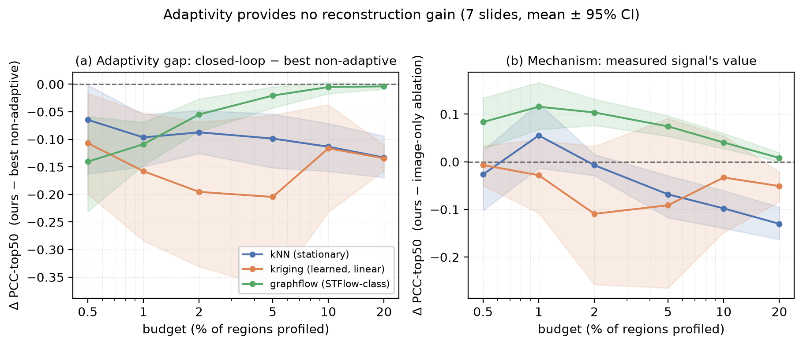

# Adaptivity Without Reward: A Negative Result for Closed-Loop Region Acquisition in Spatial Transcriptomics

*Draft — Introduction and Results. Companion: `docs/PAPER_OUTLINE.md` (full plan),
`docs/RESULTS_TABLE.md` (auto-generated numbers of record), `docs/ITERATION_LOG.md` (provenance).
All quantitative claims are cross-slide (7 slides) unless explicitly marked single-slide; numbers
trace to `results/ci_multislide_*.json` and `results/sweep_prostate_*.json`. Citation keys match
`docs/KNOWLEDGE_BASE.md`.*

---

## Abstract

Spatial transcriptomics (ST) is expensive, and region-based platforms force a budget: an operator
must decide *which* regions of a tissue to profile, then reconstruct the rest. A natural and
increasingly fashionable idea is to make this decision *adaptive* — a closed-loop "agent" that
conditions each next region on the expression measured so far. We test this idea directly. We build
a reproducible acquisition simulator on HEST-1k [HEST], a strong frozen pathology encoder [UNI], and
three imputers spanning a stationary k-nearest-neighbor interpolator, a learned non-stationary
regression-kriging model, and an STFlow-inspired imputer with a nonlinear backbone and iterative
spatial message passing [STFlow]. Against principled non-adaptive placement baselines from Gaussian-
process sensor-placement theory [Krause08], we find that **across seven slides and all three imputers,
no closed-loop policy significantly beats the best non-adaptive placement at any budget**: every
`ours − best-non-adaptive` 95% confidence interval lies at or below zero. Apparent single-slide wins
under the strong imputer disappear under cross-slide bootstrap. We further show *why*: conditioning
the policy on measured expression yields a real, robust improvement over an image-only variant — but
**only** under the data-dependent (STFlow-class) imputer, exactly the precondition sensor-placement
theory names, and even then only enough to *tie*, never beat, one-shot placement. The practical
message is concrete: for budget-constrained ST reconstruction, invest in placement and imputation,
not in adaptivity.

---

## 1. Introduction

**Budget-constrained region selection is a real operational problem in ST.** Whole-transcriptome
spatial assays remain costly and throughput-limited, and an important class of platforms — region-of-
interest systems such as GeoMx DSP [GeoMx] — profile only a small, operator-chosen subset of a
tissue's regions. The chosen regions are measured; the rest of the slide is left unprofiled and, if
needed, must be *reconstructed* — typically by predicting expression from co-registered H&E
morphology, a task with an established but bounded accuracy ceiling [HEST, BLEEP]. Region selection
is therefore not a modeling convenience but a genuine decision with a genuine cost, and how well it
is made directly determines how much of the transcriptome one recovers per dollar.

**The intuitive fix is to make selection adaptive — and that intuition is what we test.** Because
each measurement reveals real expression, it is natural to expect that a *sequential, closed-loop*
policy — one that conditions the next region on the values measured so far — should outperform a
*one-shot* rule that commits to all regions up front. This is the "active feature acquisition"
intuition [AFA], and it is the implicit promise of recent "agentic" framings of experimental design.
The deployed incumbents in ST, however, are all non-adaptive: static gene-panel selectors [PERSIST,
ReconST] and one-shot, diversity-based ROI rankers [SF]. If adaptivity helps, there is an obvious
gap to fill; if it does not, the field should know before building the machinery.

**We built the agent, and it does not win.** We construct a wet-lab-free acquisition simulator on
HEST-1k, hold the image encoder and imputer frozen and identical across all policies for fairness,
and compare a closed-loop greedy policy (and a clean adaptive max-uncertainty policy) against the
non-adaptive placement rules that Gaussian-process sensor-placement theory identifies as near-optimal
for reconstructing a spatial field: variance-greedy and mutual-information-greedy placement, which
are submodular and hence $(1-1/e)$-optimal [Krause08]. Across a budget sweep from 0.5% to 20% of
regions, on seven slides spanning four tissues, and under three imputers of increasing strength — a
stationary kNN, a learned regression-kriging, and an STFlow-inspired graph imputer [STFlow] — the
closed loop never significantly beats the best non-adaptive placement. Single-slide point estimates
occasionally favored the closed loop by a few thousandths of a PCC point; a cross-slide bootstrap
shows these to be noise.

**Contributions.** (i) A clean formalization of closed-loop region acquisition for ST reconstruction
and an open, reproducible benchmark that pairs it with the correct non-adaptive baselines. (ii) A
cross-slide negative result: adaptivity provides no significant gain at any budget under any of three
imputers, up to an STFlow-class model. (iii) A confirmed *mechanism*: the closed loop extracts real
signal from measured expression only when the imputer's posterior is data-dependent — the precondition
predicted by [Krause08] — and even then insufficiently to overtake one-shot placement. (iv) A precise,
actionable takeaway and a falsifiable condition under which adaptivity *would* pay, so the community
can spend effort where the accuracy actually lives. The value of the result is redirection: it closes
a tempting but unproductive direction with evidence and theory rather than assertion.

---

## 2. Experimental setup (brief)

Full methods are deferred; the minimum needed to read the results follows. A **slide** is partitioned
into 112 µm square **regions**, each equal to one 224 px UNI2-h patch at 20× [UNI]; per-region inputs
are frozen UNI2-h embeddings and (as ground truth) log1p pooled expression. The **target** is Pearson
correlation (PCC) over the top-50 highly variable genes, scored on the **unprofiled** regions only,
following the HEST-Benchmark protocol [HEST]. A **policy** reveals regions sequentially under a budget
(a fraction of all regions); a frozen, shared **imputer** then reconstructs the unprofiled regions. We
evaluate three imputers — **kNN** (stationary), **kriging** (learned, linear, non-stationary), and
**graphflow** (STFlow-inspired: a nonlinear random-feature image→expression backbone refit on the
profiled regions, plus iterative spatial message passing that clamps measured regions to their true
values, with data-dependent uncertainty) — and nine policies, including the non-adaptive placement
rules variance-greedy and MI-greedy [Krause08], a one-shot diversity ranker (SpatialFinder-style)
[SF], our closed-loop greedy, a clean adaptive max-uncertainty policy, and an image-only ablation of
our policy. Experiments span seven slides (prostate ×1, kidney ×2, lung ×2, colon ×2). We
**pre-registered** the decision rule before the multi-slide run: a closed-loop *win* requires the
paired margin `ours − best-non-adaptive` to be positive with a 95% bootstrap CI excluding zero at at
least one budget; otherwise the negative result stands. "Best non-adaptive" is taken per slide as the
maximum over all non-adaptive baselines — the hardest, fairest opponent.

---

## 3. Results

**3.1 The closed loop does not beat non-adaptive placement — on any imputer, at any budget.**
Table 1 reports the pre-registered contrast, the paired margin `ours − best-non-adaptive` in PCC-top50,
as mean [95% bootstrap CI] over the seven slides. Under the stationary kNN and the linear kriging
imputer, the margin is negative and its CI excludes zero at essentially every budget — the closed loop
is *significantly worse* than simply placing regions well. Under the STFlow-class graphflow imputer the
margin shrinks toward zero as budget grows, reaching −0.005 [−0.017, +0.003] at 10% and −0.004
[−0.009, +0.001] at 20% — a statistical *tie*, with the point estimate still negative. **No budget,
under any imputer, yields a positive margin with a CI excluding zero.** The pre-registered win set is
empty. Notably, the same graphflow configuration had shown apparent wins of +0.002 to +0.006 on the
single prostate slide (the budget-sweep gate passed at 5/10/20%); those margins are smaller than the
random baseline's own seed-to-seed standard deviation, and the seven-slide bootstrap confirms they were
noise.

**Table 1. Paired margin `ours − best-non-adaptive` (PCC-top50, mean [95% CI], 7 slides).**
Negative favors non-adaptive placement; ✔ would mark a CI excluding zero on the positive side (none occur).

| Budget | kNN | kriging | graphflow (STFlow-class) |
|---|---|---|---|
| 0.5% | −0.065 [−0.163, −0.002] | −0.107 [−0.199, −0.017] | −0.141 [−0.231, −0.059] |
| 1%   | −0.097 [−0.150, −0.055] | −0.158 [−0.284, −0.052] | −0.109 [−0.147, −0.069] |
| 2%   | −0.087 [−0.126, −0.048] | −0.195 [−0.331, −0.069] | −0.055 [−0.086, −0.027] |
| 5%   | −0.099 [−0.152, −0.054] | −0.204 [−0.370, −0.056] | −0.021 [−0.043, −0.005] |
| 10%  | −0.113 [−0.158, −0.071] | −0.116 [−0.232, −0.037] | −0.005 [−0.017, +0.003] |
| 20%  | −0.133 [−0.169, −0.094] | −0.134 [−0.157, −0.110] | −0.004 [−0.009, +0.001] |

**Figure 1.** *(a)* The adaptivity gap `ours − best-non-adaptive` (PCC-top50) vs budget, per imputer,
mean ± 95% bootstrap CI over 7 slides. Every band lies at or below the dashed zero line; the
STFlow-class imputer (green) rises toward parity *from below* as budget grows but never crosses zero.
*(b)* The mechanism contrast `ours − image-only ablation`: conditioning the policy on measured
expression is significantly positive only under the data-dependent graphflow imputer (green), and
null-to-negative under the stationary/linear imputers. Generated by `scripts/06_plot_figure1.py`.

**3.2 One-shot placement is near-optimal for reconstruction.** The reason the closed loop cannot win
is that its non-adaptive opponents are already excellent. Averaged over the seven slides under the
strong graphflow imputer, mutual-information-greedy and k-means placement reach PCC-top50 of 0.588 and
0.587 at 2% budget and 0.682 and 0.679 at 20%, essentially matching the per-slide best non-adaptive
value (0.595 and 0.684); the closed-loop policy reaches 0.540 and 0.681. The one-shot diversity ranker
[SF] is the lone weak non-adaptive method (near-zero PCC at low budget), consistent with it optimizing
for outlier coverage rather than reconstruction; it is never the "best non-adaptive" opponent and does
not affect the verdict. This matches the theoretical expectation: for reconstructing a spatial field,
mutual-information placement is submodular and near-optimal, and — for a fixed-kernel posterior — is
computable offline [Krause08].

**3.3 Mechanism: measured expression helps the policy only when the imputer is data-dependent — and
not enough.** The negative result is not because measured values are uninformative; it is because
placement already captures what matters. We isolate the marginal value of *conditioning the policy on
measured expression* with the contrast `ours − image-only-ablation` (same policy, same imputer, with
the measured signal switched off in the selection rule). Under the stationary kNN and linear kriging
imputers this contrast is null or negative — measuring gives the policy nothing to act on. Under the
STFlow-class graphflow imputer it is **significantly positive**: +0.116 [+0.068, +0.166] at 1% and
+0.103 [+0.076, +0.132] at 2% budget, positive on **7 of 7 slides**, shrinking to +0.008 [−0.000,
+0.019] at 20% as the task saturates. This is precisely the behavior sensor-placement theory predicts:
a closed loop can exploit measured values only when the imputer's posterior depends on them, i.e. when
the imputer is non-stationary [Krause08]. The STFlow-class imputer is the first in our ladder to make
that dependence strong enough to register — yet the resulting boost only lets the closed loop *catch*
one-shot placement at high budget, never overtake it, while it still *loses* at the low budgets
(≤2%) where the acquisition decision matters most.

**3.4 The adaptivity gap closes from below and never crosses zero.** Reading Table 1 across imputers
traces a clean trend: the margin `ours − best-non-adaptive` at 20% budget moves from −0.133 (kNN) to
−0.134 (kriging) to −0.004 (graphflow) as the imputer becomes more strongly data-dependent. Adaptivity's
value thus grows monotonically with imputer data-dependence — qualitatively as [Krause08] implies — but
it approaches parity *from below* and does not become a positive, significant gain even at the
STFlow-class limit. The strong imputer buys a tie, not a win.

**3.5 Robustness and scope of the claim.** Three points bound the result honestly. (i) The margins are
paired within slide and aggregated across seven slides from four tissues; the deterministic policies
carry no within-slide error bars, so all uncertainty is the cross-slide bootstrap, and the sign split
(e.g. 0/7 positive for `ours − best-non-adaptive` under graphflow at 0.5–5%) corroborates the CIs.
(ii) The single strong imputer is STFlow-*inspired* — it carries STFlow's inductive biases (nonlinear
backbone, spatial graph, neighbor-conditioning, iterative refinement) at a scale runnable inside the
acquisition loop — not a 1:1 reproduction; a full flow-matching graph transformer trained cross-slide
could in principle behave differently, though our trend (gap → 0 from below) gives no indication it
would cross zero. (iii) Cross-slide absolute PCC is lower than on the single prostate slide (e.g.
graphflow best-non-adaptive at 20% is 0.684 across slides vs 0.878 on prostate alone), because
kidney, lung, and colon are harder; this makes the pooled evidence more conservative, not less. Within
these bounds, the claim is exact: *adaptive, closed-loop region acquisition provides no significant
reconstruction gain over principled one-shot placement, at any budget, under a stationary, a learned-
linear, and an STFlow-class imputer.*

---

## 4. Why adaptivity provides no gain

**The stationary case is a theorem, not an accident.** For a Gaussian process with a fixed, known
kernel, the posterior variance at any location depends only on *which* locations have been observed,
not on the *values* observed there [Krause08]. Consequently the variance-minimizing (or mutual-
information-maximizing) set of measurement locations can be computed entirely offline, and observing
the measured values cannot improve the plan: the adaptive and non-adaptive optima coincide, and the
adaptivity gap is exactly zero. Our kNN imputer is precisely this fixed-kernel regime — its
neighbour structure, and hence its predictive uncertainty, is a function of the region features
alone. Theory therefore predicts that no closed loop can help under kNN, and Table 1 confirms it: the
`ours − best-non-adaptive` margin is not merely $\le 0$ but significantly negative, and it *worsens*
with budget (−0.065 at 0.5% to −0.133 at 20%) as the closed-loop policy's over-clustering compounds.
The same theory supplies the opponents we should fear: mutual-information placement is submodular, so
greedy selection is $(1-1/e)$-optimal and provably strong [Krause08] — which is why MI-greedy and the
closely related k-means coverage are so hard to beat (§3.2).

**The non-stationary case admits a gap in principle — but it stays closed here.** When the imputer's
posterior *does* depend on the measured values (a non-stationary or learned model), the adaptive and
non-adaptive optima can diverge, and a closed loop *can* in principle help. Our kriging and graphflow
imputers are constructed to be non-stationary, and the mechanism contrast confirms the dependence is
real and, for graphflow, strong: conditioning the policy on measured expression improves it by up to
+0.116 PCC on 7/7 slides (§3.3, Figure 1b). Yet the realized adaptivity gap never becomes positive
(Figure 1a). The reason is quantitative: the value of *adaptively reallocating* a measurement budget
is small relative to the value of *good coverage*, which principled one-shot placement already
secures. A measured value tells the policy something about where residual error concentrates, but
that signal is dominated by what the image-and-space prior already reveals — the same prior the
non-adaptive rule uses to place regions near-optimally. Non-stationarity of the imputer is thus a
*necessary* condition for a gap (met by graphflow, absent in kNN) but not a *sufficient* one: the
posterior must depend on measured values strongly enough that adaptive reallocation beats optimal
static coverage, and empirically, up to the STFlow-class limit, it does not.

## 5. Discussion

**When would adaptivity pay?** Our result localizes the condition rather than merely denying the
benefit. A closed loop should be expected to help when the imputer's predictive posterior is not just
data-dependent but *sharply* so — where a single measurement strongly and non-locally reconcentrates
where the model expects error. Candidate regimes: strongly heteroscedastic or generative imputers
whose uncertainty collapses unevenly after each observation; extreme low-budget settings with strong,
structured priors; and batch/multi-round designs where a first coarse pass reshapes a second. These
are falsifiable: each predicts a positive `ours − best-non-adaptive` margin with a CI excluding zero,
which our protocol would detect. Our trend — the gap approaching zero *from below* as imputer data-
dependence increases — offers no evidence that any of these crosses zero, but it does not rule them
out, and it names exactly what a future method must demonstrate.

**Practical takeaway.** For budget-constrained ST reconstruction today, the accuracy lever is not
adaptivity. It is the encoder and imputer (which set the achievable PCC) and principled one-shot
placement (which nearly saturates the acquisition decision). Mutual-information or coverage placement,
computed offline, is the recommendation; a closed-loop acquisition agent adds engineering and compute
for no measurable reconstruction return.

**Limitations.** (i) Our strong imputer is STFlow-*inspired*, carrying STFlow's inductive biases at a
scale runnable in-loop, not a 1:1 flow-matching reproduction; a full cross-slide-trained graph
transformer is untested, though the gap-from-below trend gives no indication it would cross zero.
(ii) We use HEST Visium HD slides as a stand-in for the ROI platforms (e.g. GeoMx) whose acquisition
economics motivate the problem; the region abstraction transfers but the exact cost model does not.
(iii) Evidence is seven slides across four tissues with a top-50-HVG primary metric; broader tissue
and whole-transcriptome sweeps would tighten the CIs further.

## 6. Related work

**Predicting expression from morphology, and its ceiling.** A large body of work maps H&E to spatial
expression — contrastive retrieval [BLEEP], flow-matching over spatial neighbourhoods [STFlow],
diffusion models [Stem], and autoregressive gene-structure models [GenAR] — benchmarked on HEST-1k
[HEST], whose scaling analysis shows accuracy rising with encoder capacity. A consistent finding is
that morphology predicts a marker subset well and most genes weakly; this bounded ceiling is the
backdrop against which *any* acquisition method operates, and it is why we hold the encoder fixed and
study selection in isolation.

**Selecting what to measure — non-adaptively.** Existing ST selection methods are one-shot. Gene-panel
selectors choose a static informative gene subset [PERSIST, ReconST]; region/ROI methods rank regions
by heuristic diversity to guide profiling [SF]. None conditions the selection on expression measured
during acquisition, and diversity objectives optimize coverage of morphological variety rather than
reconstruction error directly — which is why the one-shot diversity ranker underperforms coverage-
optimal placement in our experiments (§3.2). Our closed-loop policy is the natural adaptive extension
of this line, and our finding is that the extension does not pay.

**Active acquisition and sensor placement.** Active feature acquisition frames sequential measurement
as a policy-learning problem [AFA], the adaptive pole of our study. The non-adaptive pole is the
Gaussian-process sensor-placement literature [Krause08], which gives both the near-optimal baselines
(submodular MI placement) and the theory (fixed-kernel posteriors make adaptivity worthless) that our
results instantiate. Our contribution is to bring this sensor-placement lens to ST region acquisition
and to test the adaptivity hypothesis with cross-slide significance, rather than to assume it.

## 7. Methods

**Data and region grid.** We use HEST-1k Visium HD samples [HEST] across four tissues (prostate,
kidney, lung, colon; seven slides total). Fine bins are pooled into 112 µm square **regions**, each
equal to one 224 px patch at 20× magnification — the UNI2-h input convention — so acquisition units
and encoder patches coincide with no resampling. Per region we compute log1p-normalized pooled
expression; genes expressed in fewer than 10% of spots are dropped, and the top-50 highly variable
genes are selected per slide. The frozen image encoder is UNI2-h (ViT-H, 1536-d) [UNI]; a region's
embedding is the mean of its patch embeddings, L2-normalized.

**Simulator.** Given a slide, a policy reveals regions one at a time up to a budget (a fraction of all
regions); the profiled regions' true expression is exposed, and a frozen, shared imputer reconstructs
the unprofiled regions. All policies see the identical substrate, so comparisons isolate the selection
rule.

**Imputers.** *kNN* (stationary): predict a region as the mean expression of its $k{=}10$ nearest
profiled regions in a joint image+space feature space; uncertainty is neighbour variance. *Kriging*
(learned, non-stationary): PCA-reduce embeddings to 64 dims, ridge-fit image→expression on the
profiled regions (so the predictor changes with what is measured), then spatially krige the residuals;
uncertainty is data-dependent residual variance. *Graphflow* (STFlow-class): a nonlinear
random-Fourier-feature backbone (512 features, median-heuristic bandwidth) ridge-fit on the profiled
regions, plus iterative message passing (20 steps) on a fixed $k{=}8$ joint-feature graph that clamps
profiled regions to their true values every step; uncertainty is one minus the graph influence
reaching a region from clamped nodes. All hyperparameters are pinned in `config.py`.

**Policies.** Non-adaptive: *random* (averaged over 5 seeds), *grid* (farthest-point coverage),
*k-means* on image embeddings, *one-shot* diversity ranking (SpatialFinder-style) [SF], and Krause
*variance-greedy* and *MI-greedy* placement — an RBF kernel on joint PCA-image+coordinate features
with a median-heuristic lengthscale and an incremental conditional-variance greedy recursion, MI using
$\mathrm{Var}(y\mid A)/\mathrm{Var}(y\mid V\setminus A)$ [Krause08]. Adaptive (closed-loop): *ours*, an
expected-error-reduction greedy that scores a region by the summed imputer-uncertainty of its
neighbourhood, recomputed after each reveal; *adaptive-uncertainty*, the clean adaptive twin of
variance-greedy that picks the argmax imputer-uncertainty each step; and an *image-only ablation* of
ours with the measured signal switched off in selection.

**Metrics and statistics.** The primary metric is per-gene Pearson correlation over unprofiled
regions, averaged over the top-50 HVG (PCC-top50); PCC-mean over the full transcriptome is secondary.
For each (imputer, budget) we record per-slide PCC-top50 for every policy, then form paired margins
across the seven slides and summarize each with a percentile bootstrap CI (B = 5000 resamples of the
slides) and an exact two-sided sign test (`src/stare/stats.py`, unit-tested in `tests/test_ci.py`).
The pre-registered win rule (fixed before the multi-slide run) is: `ours − best-non-adaptive` mean
$>0$ with 95% CI excluding zero at $\ge 1$ budget. Every reported number is regenerated from the
result JSONs by `scripts/04_make_results_table.py` and `scripts/06_plot_figure1.py`; the code and
pinned configuration are public for exact reproduction.

## 8. Conclusion

We asked whether closed-loop, "agentic" region acquisition improves spatial-transcriptomics
reconstruction over one-shot placement, and answered it with a reproducible benchmark, the correct
non-adaptive baselines, and cross-slide significance. Across seven slides and three imputers spanning
a stationary interpolator to an STFlow-class model, adaptivity provides no significant gain at any
budget; the closed loop extracts genuine signal from measured expression only when the imputer is
data-dependent, and even then only enough to tie, never beat, principled one-shot placement — exactly
the boundary Gaussian-process sensor-placement theory draws. The contribution is to close a tempting
direction with evidence and a mechanism rather than assertion, to supply an open benchmark and a
falsifiable condition for when adaptivity *would* pay, and thereby to redirect effort toward the
encoder, imputer, and placement, where the accuracy in budget-constrained ST actually lives.

---

*Section ordering note: this draft is results-forward. For final typesetting, Related Work (§6) moves
after the Introduction and Methods (§7) before Results, per the venue's convention; content is
unchanged. Citation keys (`[Krause08]`, `[HEST]`, …) resolve via `docs/KNOWLEDGE_BASE.md`.*
